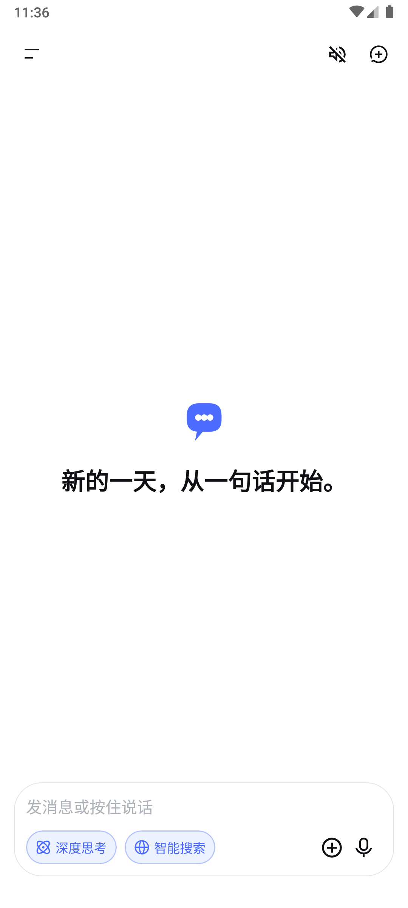
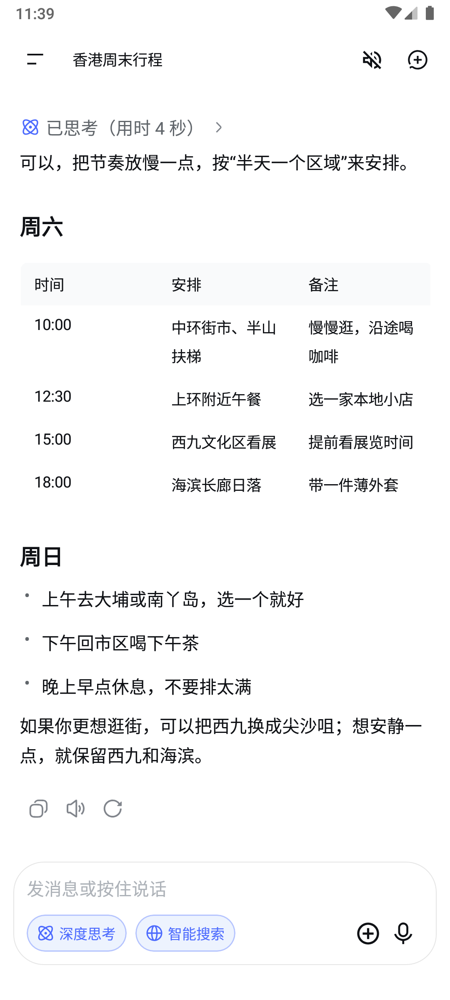
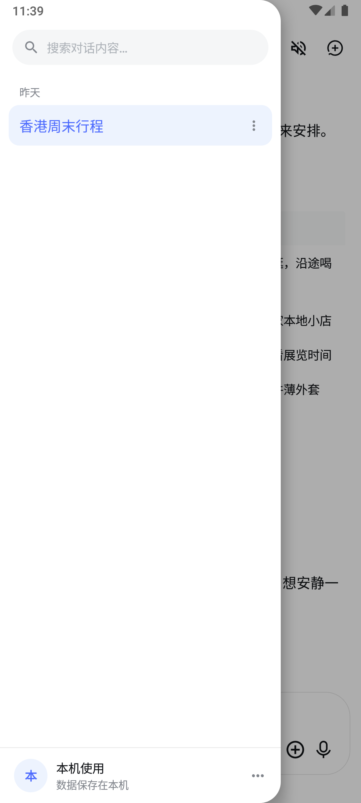
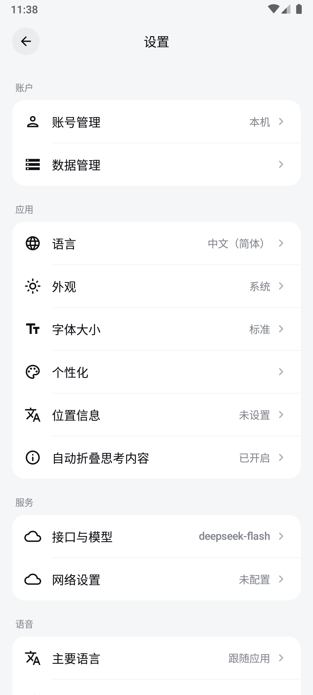

# Chat 本地 AI 对话全栈

一个可自托管的中性品牌 Chat 应用，包含网页版、Node 账号/会话后端、原生 Android 客户端，
以及本地 CosyVoice3、GPT-SoVITS、M5-TTS 和 Whisper 语音服务。

项目默认本地优先，也可以连接自己的服务器，实现多账号、云端会话同步和按用户保存的模型/语音设置。
模型服务地址、搜索服务和语音服务地址都可以独立配置，不绑定任何官方 API。

> English README: [README.en.md](README.en.md)

## App 截图

<p align="center">
  
  
  
  
</p>

## 目录结构

```text
chat/                 React + TypeScript 网页前端
chat/server/          Node 账号与会话后端（JSON 存储、HttpOnly Cookie）
android-app/          Kotlin + Jetpack Compose 原生 Android 客户端
cosyvoice3/           CosyVoice3 TTS + Whisper ASR 适配器及上游源码
gpt-sovits/           GPT-SoVITS V5 Turbo 本地 TTS 服务
m5-tts/               M5-TTS 50M ONNX 试验性 TTS 服务
```

根目录还包含：

- `LICENSE`：本仓库原创代码的 MIT 许可证
- `THIRD_PARTY_NOTICES.md`：上游项目和第三方依赖的许可证说明
- `README.en.md`：英文说明

## 主要功能

### 网页端

- 流式 Markdown 回答、思维链、联网搜索与引用
- 会话分支、编辑、重新生成、继续生成、停止
- 图片/PDF/Word/PPT/Excel/文本附件；文件在本机解析，不依赖文件上传接口
- 图片本地压缩后以 base64 发送
- 网页 PWA、移动端适配、浅色/深色主题
- 用户注册/登录、服务端按账号存储会话
- 每个账号独立保存 LLM/搜索/语音 Base URL 和 API Key
- 自定义模型 ID、获取模型列表、本地标题兜底
- 本地 TTS 朗读、浏览器/服务端 ASR 语音输入
- HTML 代码预览、代码复制、引用来源面板

### Android 客户端

- 原生 Jetpack Compose，不使用 WebView 套壳
- 与网页一致的消息布局、思维链、搜索来源、附件和设置结构
- 抽屉、设置页、搜索结果页的叠加动画和共享元素转场
- 本地优先：不连接服务器也能完整使用
- 可选连接服务器并登录，支持本地会话合并/替换
- 本地文件解析：PDF、DOCX、PPTX、XLSX 和纯文本
- 语音输入录音、TTS 流式播放、加载/播放两种朗读动画
- 字体大小、主题色、气泡样式、聊天背景、位置信息、自动折叠思考
- App 内“设置 → 开源许可”展示第三方项目许可证摘要

### 语音服务

- CosyVoice3：中文、英文、日文、韩文、俄文，零样本音色
- GPT-SoVITS V5 Turbo：原生 48 kHz，少步采样
- M5-TTS 50M ONNX：轻量试验引擎，CUDA/CPU
- Whisper：本地语音识别
- 统一 8000 端口适配器：`/tts`、`/asr`、`/health`
- GSV/M5 使用独立上游服务，客户端断开后停止后续推理

## 环境要求

- Node.js 20+、pnpm
- Python 3.10（语音服务）
- Windows 10/11（一键脚本按 Windows 编写；其他系统可手动启动）
- 可选 NVIDIA GPU + CUDA（CosyVoice/GPT-SoVITS/M5 GPU 推理）
- Android 构建：JDK 17+、Android SDK 35

## 快速开始

### 1. 网页前端 + 账号后端

```bat
cd chat
pnpm install
cd server
npm install
cd ..
pnpm exec rspack build -c rspack.config.ts
cd server
set HOST=0.0.0.0
set PORT=8098
node index.mjs
```

打开 `http://localhost:8098/`。生产模式下由 Node 后端同时提供前端静态文件和 `/api`。

前端开发模式：

```bat
chat\start-chat.bat
```

开发服务器监听 8090，并把 `/api` 代理到 8098；需要先启动 `chat\start-backend.bat`。

### 2. 本地语音服务

各服务的模型下载、虚拟环境和依赖安装说明见对应目录：

- `cosyvoice3/README.md`：CosyVoice3 + Whisper
- `gpt-sovits/README.md`：GPT-SoVITS V5 Turbo
- `m5-tts/README.md`：M5-TTS ONNX

模型权重不随仓库分发，首次运行前需要按各 README 下载。

### 3. 一键启动脚本

完整启动会构建前端、启动后端、语音适配器和所选 TTS 引擎，然后打开
`http://localhost:8098/`：

```bat
chat\start-all.bat        CosyVoice + Whisper
chat\start-all-gsv.bat    GPT-SoVITS V5 Turbo + Whisper
chat\start-all-m5.bat     M5-TTS + Whisper
```

单独启动：

```bat
chat\start-backend.bat    构建并启动账号/会话后端 8098
chat\start-chat.bat       前端开发服务器 8090
chat\start-tts.bat        CosyVoice + Whisper 8000
chat\start-gsv.bat        GPT-SoVITS 8002
chat\start-m5.bat         M5-TTS 8001
chat\stop-all.bat         停止本机全部服务
```

关闭一键启动的控制台窗口会停止由它启动的服务。

### 4. 原生 Android 客户端

```bat
cd android-app
gradlew assembleRelease
```

产物位于 `android-app/app/build/outputs/apk/release/app-release.apk`。

首次启动默认是本地模式，不需要服务器。需要云端账号时，在“设置 → 账号管理”填写服务器地址并登录。
模型/搜索/语音接口在“设置 → 网络设置”中分别配置。

## 端口

| 端口 | 服务 |
| --- | --- |
| 8098 | 账号/会话后端 + 生产版网页/PWA |
| 8090 | 前端开发服务器 |
| 8000 | 语音适配器（TTS 代理 + Whisper ASR） |
| 8001 | M5-TTS（可选） |
| 8002 | GPT-SoVITS（可选） |

## 配置说明

- **LLM 地址**：兼容 Anthropic Messages API 的 Base URL，例如 `https://api.example.com/anthropic/v1`
- **搜索地址**：兼容搜索接口的 Base URL；可留空使用默认值
- **语音地址**：适配器 Base URL，例如 `http://<服务器>:8000`
- **API Key**：LLM/搜索/语音可分别设置；搜索或语音留空时会回退到 LLM Key
- **模型**：可以手动填写模型 ID，也可以从 `/models` 获取后加入列表
- Android 与网页都不会在保存时主动校验 API Key，实际请求时才会验证

## 数据与安全

- 网页账号密码使用 scrypt 哈希；登录使用 HttpOnly、SameSite=Lax Cookie
- 服务端会话位于 `chat/server/data/sessions/<userId>/`，已被 git 忽略
- 网络设置按账号保存在服务器，使用 AES-256-GCM 加密
- Android 的 API Key、Cookie 和网络设置使用 Android Keystore 加密
- 本地 TTS/ASR 服务没有鉴权，只应部署在可信局域网；公网部署请使用 HTTPS 和反向代理
- 服务端用户数据和 `settings.key` 不在仓库中

## PWA / 手机安装

后端会提供 `manifest.webmanifest`、Service Worker 和图标。Service Worker 与安装提示需要
安全上下文：HTTPS（可信证书）或 `localhost`。通过普通 `http://<局域网IP>:8098` 访问时网页
仍可使用，但浏览器不会启用完整的 PWA 离线/安装能力。

## 开发与检查

网页：

```bat
cd chat
pnpm type
pnpm lint
pnpm exec rspack build -c rspack.config.ts
```

Android：

```bat
cd android-app
gradlew testReleaseUnitTest
gradlew assembleDebug
gradlew assembleRelease
```

## 不包含的内容

- CosyVoice3、GPT-SoVITS、M5-TTS、Whisper 的模型权重
- Python/Node 虚拟环境和 `node_modules`
- 服务端用户数据、加密密钥、Cookie、API Key
- 签名 keystore 和构建产物
- 额外录音素材（仓库仅保留当前 `stella.wav` 参考音频）

## 许可证

本仓库原创代码使用 [MIT License](LICENSE)。

`chat-demo`、CosyVoice、GPT-SoVITS、M5-TTS、Whisper、Matcha-TTS、BigVGAN 以及 Android/网页
第三方依赖继续适用各自的许可证。完整说明见 [THIRD_PARTY_NOTICES.md](THIRD_PARTY_NOTICES.md)。

DeepSeek 名称、鲸鱼标识等商标不包含在 MIT 许可中；本仓库使用中性的 Chat 品牌，与 DeepSeek
官方无关联。

## 上游项目

- [deepseek-ai/chat-demo](https://github.com/deepseek-ai/chat-demo)（MIT）
- [FunAudioLLM/CosyVoice](https://github.com/FunAudioLLM/CosyVoice)（Apache-2.0）
- [RVC-Boss/GPT-SoVITS](https://github.com/RVC-Boss/GPT-SoVITS)（MIT）
- [ASLP-lab/M5-TTS](https://github.com/ASLP-lab/M5-TTS)（以其代码/权重发布条款为准）
- [openai/whisper](https://github.com/openai/whisper)（MIT）
